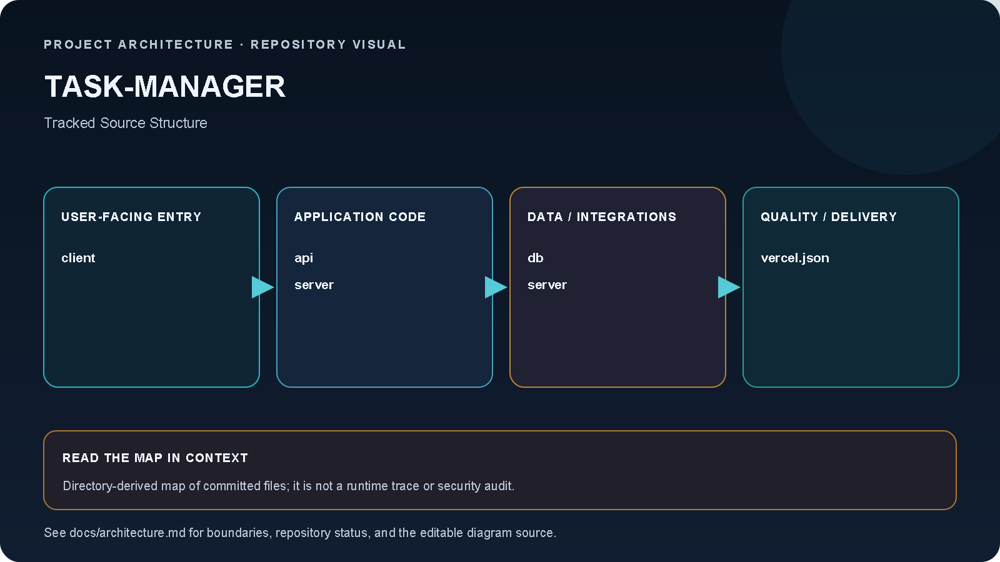
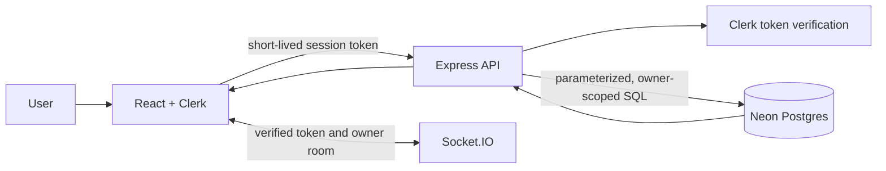

# Task Manager

TaskFlow is a React task dashboard with Clerk sign-in, an Express API, owner-scoped Neon PostgreSQL persistence, and private Socket.IO updates.
**Live link:** [https://task-manager-five-virid-60.vercel.app](https://task-manager-five-virid-60.vercel.app)

## Architecture



[Architecture notes](docs/architecture.md) · [Editable SVG](docs/images/task-manager-architecture.svg)




The browser receives only the Clerk publishable key. The server verifies every API and socket session, derives the task owner from the Clerk subject, and scopes database reads, writes, and events to that owner. No uploaded files are stored by this application, so it does not require object storage.

## Local setup

1. Copy `.env.example` to the appropriate local environment files; never commit real values.
2. Set `VITE_CLERK_PUBLISHABLE_KEY` for the client. Set `CLERK_SECRET_KEY` (or Clerk's `CLERK_JWT_KEY`), `CLERK_AUTHORIZED_PARTIES`, and `DATABASE_URL` only in the server environment.
3. From `server/`, run `npm install`, `npm test`, then `npm run dev`.
4. From `client/`, run `npm install`, `npm run dev`.

`server/db.js` creates the required schema at startup. The equivalent reviewed SQL is in `db/migrations/001_tasks.sql` for managed migration workflows. The old JSON user/task store is no longer read; existing local records are not migrated automatically. Export and map them only after verifying their ownership and obtaining Clerk identities.

## Checks

```bash
cd server && npm test
cd ../client && npm run build
```

These checks cover fail-closed session validation, owner-scoped parameterized SQL, and the client production build. A successful local build does not provision Clerk or Neon; configure the deployment environment before enabling sign-in and durable storage.

## Security notes

- Never put `CLERK_SECRET_KEY`, `CLERK_JWT_KEY`, or `DATABASE_URL` in browser configuration or source control.
- Set exact production origins in `CLERK_AUTHORIZED_PARTIES` / `CLIENT_ORIGINS`; wildcard CORS is disabled.
- Task events are sent to the authenticated user's socket room, not broadcast account-wide.
- Task titles, descriptions, state, and dates are validated by the API; SQL values are parameterized.
- Do not reuse the prior local JSON password store. Those credentials are not accepted after this migration.
