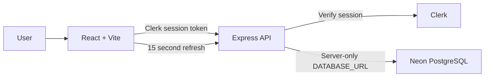

# Task Manager

TaskFlow is a React task manager with private per-user task lists. Clerk handles identity, the Express API verifies Clerk sessions, and Neon stores durable task records. No file upload flow exists, so the app does not use object storage.

## Architecture



## Configure

1. Create a Clerk application and enable the sign-in methods you want.
2. Create a Neon PostgreSQL database.
3. Apply [`server/database/migrations/0001_tasks.sql`](server/database/migrations/0001_tasks.sql) to the database using the Neon SQL editor or `psql`.
4. Copy `client/.env.example` to `client/.env.local` and set `VITE_CLERK_PUBLISHABLE_KEY`. Copy `server/.env.example` to `server/.env` and set `CLERK_SECRET_KEY`, `DATABASE_URL`, and `CORS_ORIGINS`. Never prefix server secrets with `VITE_`.
5. Add the frontend origin to the Clerk allowed origins and `CORS_ORIGINS` (comma-separated) in the API environment.

Existing local JSON users cannot be mapped safely to Clerk identities automatically. The old file-backed store is no longer used; create a new account through Clerk and migrate any needed task data only after matching each record to its verified owner.

## Run locally

Install the root/server and client dependencies, configure the environment values, then run the API and Vite client in separate terminals:

```bash
npm install
npm --prefix client install
npm run dev --prefix server
npm run dev --prefix client
```

The API listens on port `5000`; the Vite client listens on `3000` and proxies `/api` to `http://localhost:5000`.

## Checks

```bash
npm test
npm run build
```

Unit tests cover ownership scoping, SQL parameter binding, and rejection of unauthenticated requests. A real sign-in or database operation additionally requires owner-provisioned Clerk and Neon credentials.
