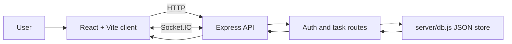

# Task Manager

<p align="center"><strong>A task-tracking web app prototype with user registration, a React dashboard, and real-time task events over Socket.IO.</strong></p>

<p align="center">React · Vite · Express · Socket.IO · JSON file storage</p>

## Project overview

The client organizes tasks in a dashboard and uses authentication context for sign-in state. The Express server exposes authentication and task routes and creates a Socket.IO server for connected clients. The `api/` entry adapts HTTP routes for serverless hosting.

## Architecture



## Run locally

Use Node.js and open two terminals from the repository root:

```bash
cd server
npm install
npm run dev
```

```bash
cd client
npm install
npm run dev
```

The server defaults to port `5000`. Open the Vite URL printed by the client and make sure its API/socket configuration points to the local server.

## Storage and deployment limits

Task and user records are written to `server/store.json`. This local file-based store can be lost or become unreliable on serverless hosts and is not designed for concurrent production traffic. The server also allows broad CORS origins in its current configuration. Use a persistent database, scoped CORS, and production-grade authentication before using real accounts or deploying for a team.

## Project structure

- `client/` — React pages, task components, and auth context
- `server/` — Express, Socket.IO, routes, middleware, and JSON store
- `api/index.js` — serverless HTTP adapter
- `vercel.json` — deployment routing
